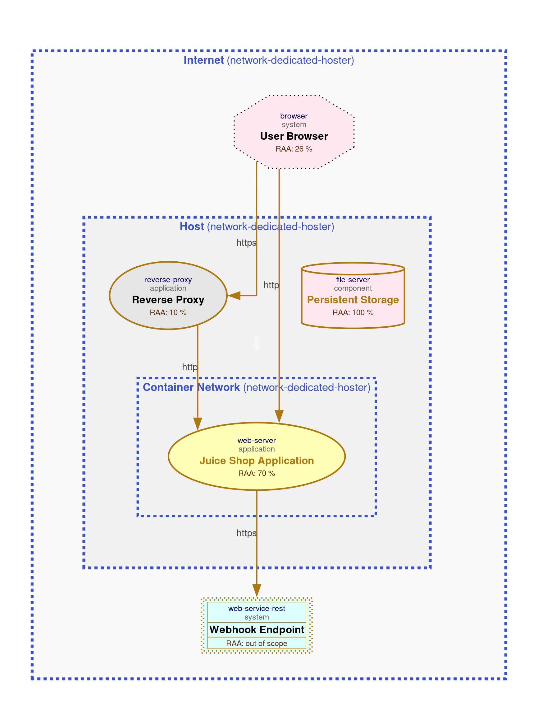

### Data Flow Diagram (DFD)

## Task 2

### Baseline vs. Secure comparison (2.5)

| Severity | Baseline | Secure | Delta |
| :--- | :---: | :---: | :---: |
| Critical | 0 | 0 | 0 |
| High | 0 | 0 | 0 |
| Elevated | 4 | 1 | -3 |
| Medium | 14 | 12 | -2 |
| Low | 5 | 5 | 0 |
| **Total** | **23** | **18** | **-5** |

### Rule diff (`comm` output)
- **Gone (`comm -23`):** `missing-authentication`, `unencrypted-asset`, `unencrypted-communication`
- **New (`comm -13`):** *(none)*

### Remaining risk & architectural takeaway
- **Remaining `elevated` risk:** `cross-site-scripting` on `juice-shop` (**Cross-Site Scripting (XSS) risk at Juice Shop Application**).
- **What it takes to close it & why no YAML edit can fix it:** Infrastructure and architecture hardening (enforcing HTTPS in transit, mutual client-certificate authentication, and transparent encryption at rest) protects communication channels and storage, but cannot sanitize untrusted user input inside the web application itself. Closing XSS requires code-level fixes (context-aware output encoding, strict input validation, and a `Content-Security-Policy` header).
